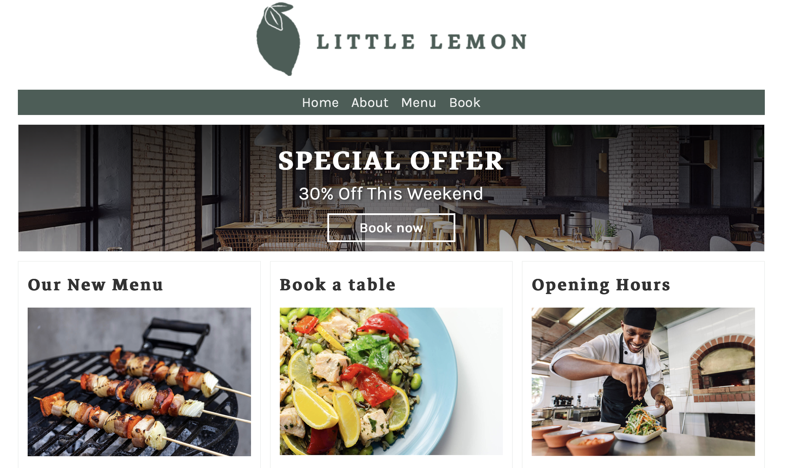
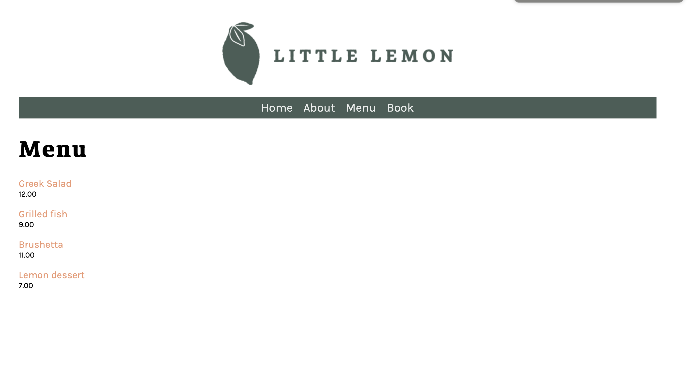

# Little Lemon Restaurant

A Django website for Little Lemon, a fictional restaurant.

## Features
- Home page with restaurant information
- Menu page
- Static images and styling

## Tech Stack
- Python
- Django
- SQLite
- HTML / CSS
- Pipenv

## Screenshots






## Run Locally
```
git clone https://github.com/Anugragha/little-lemon-restaurant
cd little-lemon-restaurant
pipenv install
pipenv shell
python manage.py migrate
python manage.py runserver
```
Open http://127.0.0.1:8000/ in your browser.

## Future Improvements
- Table booking form
- User accounts